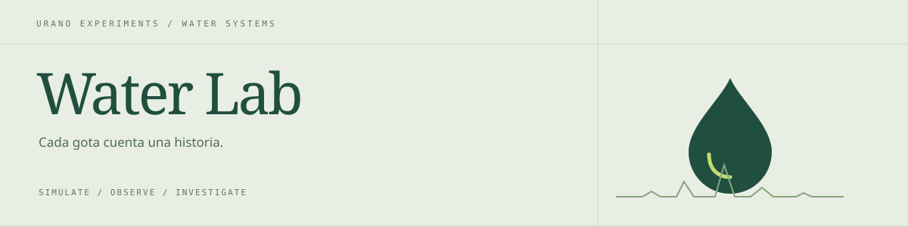
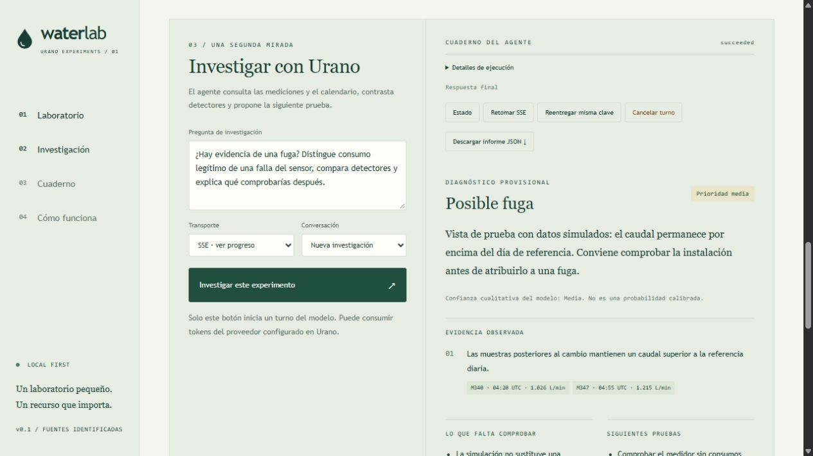
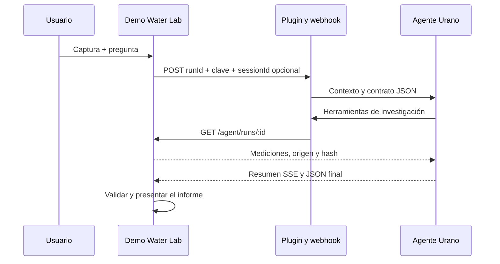
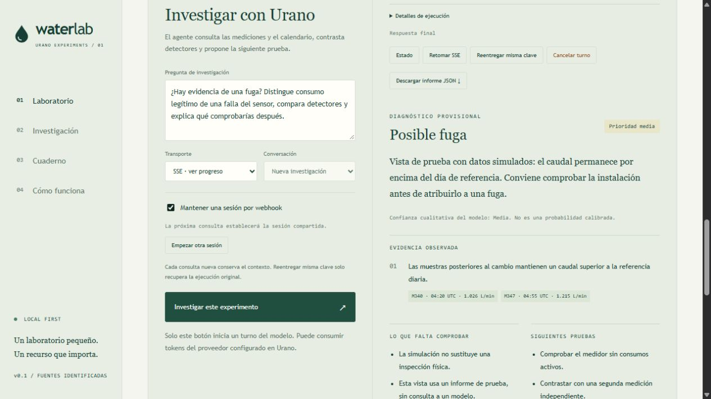

<p align="center">
  
</p>

<h1 align="center">Water Lab · Demo</h1>

<p align="center"><strong>Simula una fuga. Importa una medición. Investiga con evidencia.</strong><br />Un laboratorio local para conectar series de consumo de agua con un agente de Urano Desktop.</p>

<p align="center"><a href="#inicio-rápido">Inicio rápido</a> · <a href="#conectar-urano">Conectar Urano</a> · <a href="#demostraciones">Demostraciones</a> · <a href="#datos-externos">Datos externos</a> · <a href="#desarrollo-y-contribuciones">Contribuir</a></p>

**Node.js 24+ · Sin dependencias de runtime · HTTP + SSE · Persistencia local**

Water Lab permite explorar si un aumento de consumo se explica por una fuga, una actividad legítima o un sensor defectuoso. Reproduce escenarios con una semilla, compara dos detectores y pide al agente que consulte las mediciones antes de elaborar un informe.

La conexión entre la demo y el plugin es HTTP real. Los datos pueden proceder del simulador, de un CSV o de un gateway de sensores. Cada captura conserva su origen y un hash; el agente recibe las observaciones sin acceder a la verdad oculta del simulador.

> Las simulaciones y los detectores funcionan sin LLM. Solo **Investigar este experimento** inicia una consulta al modelo configurado en Urano y puede consumir tokens.

## Qué puedes hacer

- Reproducir seis escenarios y comparar umbral fijo frente a residual persistente.
- Importar CSV o recibir lecturas mediante HTTP autenticado.
- Crear capturas inmutables y consultar su evidencia mediante herramientas MCP.
- Obtener informes JSON con diagnóstico, muestras, incertidumbre y acciones propuestas.
- Ver el resumen en vivo por SSE y recuperar ejecuciones después de una desconexión.
- Mantener una sesión por webhook o trabajar con consultas aisladas.
- Exportar capturas e informes y conservar el cuaderno en disco.

## Vista del laboratorio



*Captura de revisión visual con datos simulados e informe de prueba. No representa una respuesta de un modelo ni una medición física.*

## Inicio rápido

Necesitas **Node.js 24 o superior** con npm. Desde la carpeta del proyecto:

```bash
npm run setup
npm start
```

Abre [http://127.0.0.1:3020](http://127.0.0.1:3020).

No necesitas `npm install` para arrancar la demo: utiliza módulos incluidos en Node.js. El primer acceso crea una simulación si el cuaderno está vacío, sin llamar al modelo.

`setup` genera `.env` con tres secretos independientes. Si el archivo existe, conserva sus credenciales y añade el token de sensores cuando falta:

- `URANO_TOKEN`: autentica la demo ante el webhook.
- `LAB_API_TOKEN`: autentica las consultas de evidencia del plugin.
- `SENSOR_INGEST_TOKEN`: autentica al gateway que entrega lecturas.

`PORT` usa `3020` por defecto. `URANO_URL` proporciona la URL inicial del webhook. Consulta [.env.example](.env.example) y mantén `.env` y `data/` fuera de los commits.

## Conectar Urano

Para investigar con IA necesitas Urano Desktop con protocolo de webhooks v1, el plugin compañero **water-lab** y un proveedor/modelo configurado. Ambos proyectos pueden vivir en cualquier carpeta; una organización posible es:

```text
workspace/
├── UranoDesktop-plugins/water-lab/   # Plugin con config.ts
└── UranoDesktop-demos/water-lab/     # Esta demo
```

1. En **MCP Manager → Desarrollador / DevTools → Vincular carpeta local**, selecciona la carpeta del plugin que contiene `config.ts`. También puedes instalar su ZIP compilado.
2. Configura el Vault del plugin:
   - `INCOMING_WEBHOOK_SECRET`: valor `URANO_TOKEN` del `.env` de la demo.
   - `LAB_API_TOKEN`: valor homónimo del mismo `.env`.
   - `LAB_BASE_URL`: `http://127.0.0.1:3020`.
   - `INTEGRATION_ID`: `water-lab-local`; conserva esta identidad al rotar secretos.
3. Crea un agente dedicado, configura su modelo, habilita **water-lab** y lánzalo. Selecciónalo en `TARGET_AGENT` del plugin.
4. En la demo, pega esta URL en **Configurar webhook** y pulsa **Guardar URL**:

   ```text
   http://127.0.0.1:6274/v1/webhook/mcp_water-lab/default
   ```

5. Pulsa **Comprobar conexión** y después **Investigar este experimento**, con **SSE · ver progreso** seleccionado.

Discovery comprueba el endpoint y protocolo. La primera investigación con herramientas verifica además autenticación, agente y conexión de vuelta al servicio de evidencia. Vincular un plugin no actualiza un core antiguo.

El navegador no recibe los secretos. La demo autentica sus peticiones al webhook; el plugin autentica sus lecturas de evidencia por separado. El proveedor LLM pertenece al agente de Urano.

## Arquitectura



`runId` identifica la captura; `sessionId`, la conversación; `turnId`, una ejecución. Una conversación puede investigar varias capturas, pero cada informe se valida contra la evidencia de su turno.

## Demostraciones

### 1. Encontrar una fuga pequeña

Selecciona **Fuga silenciosa**, semilla `42`, pérdida `0.8 L/min`. El umbral fijo no detecta esta fuga; el residual persistente sí: con esos parámetros marca la primera señal tras 55 minutos entre timestamps, con 48 L perdidos incluyendo el intervalo que dispara la alarma.

> ¿Qué evidencia distingue esta señal de un aumento legítimo del consumo? ¿Qué comprobarías antes de recomendar una reparación?

### 2. Evitar una falsa alarma por riego

Selecciona **Riego programado** y semilla `42`. El umbral fijo produce falsas alarmas de fuga; el residual ajustado por calendario las evita.

> Contrasta los detectores y explica si hay evidencia suficiente para atribuir el aumento a una fuga.

### 3. Investigar la calidad de la medición

Prueba **Sensor congelado** y **Telemetría interrumpida**. Una línea plana no confirma consumo estable; una lectura ausente no equivale a cero.

> ¿Investigarías primero la instalación o el medidor? Indica la siguiente prueba útil y las limitaciones.

Usa **Rotura de tubería** para comparar rapidez de detección y **Un día normal** como control. Repite con otras semillas y exporta las capturas.

### 4. Comparar con memoria de conversación

Activa **Mantener una sesión por webhook**, envía una pregunta, cambia de captura y consulta de nuevo. La demo reutiliza el `sessionId` y crea un turno nuevo.

**Empezar otra sesión** hace que la siguiente consulta establezca otra conversación, sin borrar el historial. Desactiva la casilla para consultas aisladas o continuidad manual.

<details>
<summary>Ver los controles de continuidad</summary>



*Captura de revisión visual con informe de prueba.*

</details>

## Informes JSON

El contrato `water-lab.report.v1` permite presentar diagnóstico provisional, prioridad, resumen, hallazgos con muestras, incertidumbres, siguientes pruebas y acciones propuestas. El informe validado puede descargarse como JSON.

El resumen se muestra como borrador durante SSE. Al finalizar se comprueban estructura, `runId`, hash e índices de muestras. Los timestamps y caudales junto a cada hallazgo se obtienen de la captura, no del texto del modelo.

El lector admite narración alrededor del JSON, pero no repara objetos incompletos ni elige entre informes válidos distintos. Si falla la validación, conserva la respuesta original. Los resultados guardados se vuelven a interpretar al recargar sin otra invocación.

La validación comprueba estructura y referencias, **no la corrección de cada conclusión**. La confianza mostrada es cualitativa, no una probabilidad calibrada.

Contrato y ejemplo: [docs/REPORT_CONTRACT.md](docs/REPORT_CONTRACT.md).

## Datos externos

### CSV

En **Fuentes de medición**, elige un archivo y su intervalo de **5, 15 o 60 minutos**. Las columnas son `timestamp` y `flowLpm`, en cualquier orden:

```csv
timestamp,flowLpm
2026-01-01T00:00:00Z,0.4
2026-01-01T00:05:00Z,0.5
2026-01-01T00:10:00Z,
```

Este ejemplo ilustra el formato y no procede de hardware. Usa timestamps con zona horaria, L/min y punto decimal. Una celda vacía representa ausencia de datos. Máximo: **100 KB y 576 intervalos** por captura; los huecos se conservan.

### Gateway HTTP de sensores

Un gateway local puede recibir mediciones de un dispositivo y entregarlas al receptor:

```http
POST /ingest/readings
Host: 127.0.0.1:3020
Authorization: Bearer <SENSOR_INGEST_TOKEN>
Content-Type: application/json

{"sensorId":"medidor-01","unit":"L/min","samplingMinutes":5,"readings":[{"timestamp":"2026-01-01T00:00:00Z","flowLpm":0.4}]}
```

Sustituye los valores del ejemplo por tus lecturas. La ventana móvil conserva hasta 576 intervalos por sensor. Una lectura idéntica no se duplica; un valor conflictivo para el mismo timestamp devuelve `409`.

Pulsa **Crear captura** para investigar una versión inmutable. Las entregas posteriores no alteran esa evidencia ni llaman automáticamente al modelo.

El servidor escucha en loopback. Un dispositivo remoto necesita un gateway local: esta versión no incluye drivers serial/MQTT ni publica el puerto en la LAN. La integración se verifica con lecturas de prueba, sin hardware físico conectado.

Guía completa: [docs/REAL_DATA.md](docs/REAL_DATA.md).

## Detectores y métricas

Las simulaciones contienen 48 h UTC, con intervalos de 5 min: 24 h de referencia y 24 h de evaluación.

- **Umbral fijo:** más de `12 L/min` durante 3 muestras consecutivas.
- **Residual persistente:** diferencia superior a `0.18 L/min` frente a la misma hora del día de referencia, descontando riego declarado, durante 12 muestras.
- Ambos incorporan señales heurísticas de ausencia de datos y repetición exacta de lecturas.

Con datos externos se respeta el intervalo declarado y se indica si falta referencia suficiente. El primer día se toma como referencia sin certificar que la instalación estuviera sana.

Solo las simulaciones permiten medir aciertos, falsas alarmas, retraso y pérdidas contra una verdad oculta, que se excluye de las herramientas del agente. Para CSV y sensores esas métricas no se fabrican.

El volumen integra lecturas disponibles. La pérdida hasta la alarma incluye el intervalo que la dispara; sin detección, suma toda la pérdida del horizonte. El ahorro de reparación es un contrafactual condicionado, no una medición ni una acción física.

## Sesiones y recuperación

- **HTTP wait:** espera el resultado. **Async:** conserva IDs y permite consultar Estado. **SSE:** entrega progreso, conserva borrador y cursor y permite recuperar eventos sin duplicarlos.
- **Sesión única:** vínculo persistente por URL; bloquea consultas nuevas mientras haya una ejecución pendiente. Desactivada, puedes elegir una conversación terminada del mismo experimento o empezar sin contexto anterior.
- **Reentregar misma clave:** con `turnId`, consulta ese turno por `status` sin invocar al agente. Sin `turnId`, exige protocolo v1 y reenvía exactamente cuerpo y clave originales.
- **Retomar SSE:** usa `events` y `Last-Event-ID`; si el historial expiró (`410`), consulta Estado.
- **Cancelar turno:** solicita cancelación cooperativa; el estado terminal del core es el autoritativo.

La idempotencia del core dura 24 h. La demo bloquea entregas inciertas sin `turnId` a partir de 23 h. Desconectar o agotar la espera HTTP/SSE no cancela la ejecución.

La URL guardada en la interfaz tiene prioridad sobre `URANO_URL`. Cada trabajo conserva su destino original; cambiar de webhook no transfiere sesiones ni redirige controles anteriores.

## API y persistencia

```text
GET   /health                         Estado del servicio
GET   /api/state                      Capturas y configuración pública
GET   /api/events                     SSE de cambios locales
GET   /api/discovery                  Discovery del webhook
POST  /api/runs                       Simular captura
POST  /api/import/csv                 Importar CSV
POST  /api/connection                 Guardar URL
POST  /api/session-policy             Activar/desactivar sesión única
POST  /api/session-reset              Empezar otra sesión en la próxima consulta
POST  /api/jobs                       Investigar una captura
POST  /api/jobs/:id/status|events|retry|cancel|cancel-active
POST  /api/sensors/:id/snapshot        Congelar lecturas
POST  /ingest/readings                Entrega autenticada de lecturas
GET   /agent/runs/:id                 Evidencia autenticada
GET   /agent/runs/:id/compare          Comparación ciega
POST  /agent/runs/:id/intervention     Reparación hipotética
```

Los archivos de capturas, trabajos y sensores se guardan en `data/` mediante archivo temporal y rename. `connection.json` conserva la URL y `sessions.json`, los vínculos de conversación.

Cada trabajo conserva hasta 200 metadatos de eventos y 64.000 caracteres de borrador. Las actualizaciones de tokens se agrupan cada 60 ms. La interfaz carga las 100 capturas e investigaciones más recientes y ofrece accesos rápidos a 12. No hay rotación automática del disco; usa una sola instancia por directorio de datos.

## Resolver problemas

- **404 en discovery:** revisa vínculo del plugin, URL y protocolo v1 del core.
- **Autenticación rechazada:** comprueba los pares `URANO_TOKEN` ↔ `INCOMING_WEBHOOK_SECRET` y `LAB_API_TOKEN` ↔ `LAB_API_TOKEN`. El token del sensor es independiente.
- **La herramienta no conecta:** mantén la demo encendida y revisa `LAB_BASE_URL`; si cambias `PORT`, actualiza ese ajuste del plugin.
- **Informe inválido:** consulta el original y verifica que el JSON esté completo y cite la evidencia de la captura. Actualiza demo y plugin.
- **Conversaciones nuevas:** activa Mantener una sesión por webhook; consultar de nuevo y recuperar un turno son operaciones distintas.
- **Trabajo pendiente tras reiniciar:** consulta Estado para reconciliarlo; la demo no lo vuelve a ejecutar automáticamente.

## Desarrollo y contribuciones

```bash
npm test
```

Las pruebas no necesitan proveedor LLM. Cubren simulación, CSV, recepción HTTP, capturas inmutables, autenticación, informes, SSE fragmentado, replay, recuperación y continuidad de sesión.

```text
public/          Interfaz, gráficos y presentación de informes
src/model.mjs    Simulador, detectores y evidencia
src/sources.mjs  CSV y normalización de sensores
src/urano.mjs    Cliente HTTP/SSE
src/stream.mjs   Texto progresivo y deduplicación
src/server.mjs   API, persistencia y continuidad
docs/           Guías y contratos
test/           Pruebas deterministas e integración local
```

Para contribuir, describe el experimento o problema, aporta un fixture mínimo sin secretos y ejecuta las pruebas pertinentes. Distingue lo observado, lo simulado y lo inferido; incluye alternativas plausibles y un control al proponer escenarios.

## Alcance actual

Este es un laboratorio experimental local. Sus detectores no son un sistema hidráulico validado ni certifican fugas. No opera válvulas ni verifica por sí mismo la calibración de un instrumento.

No incluye login ni despliegue multiusuario. Verifica Host y Origin y no habilita CORS. Su persistencia no sustituye un scheduler recuperable ni garantiza efectos externos exactamente una vez.
